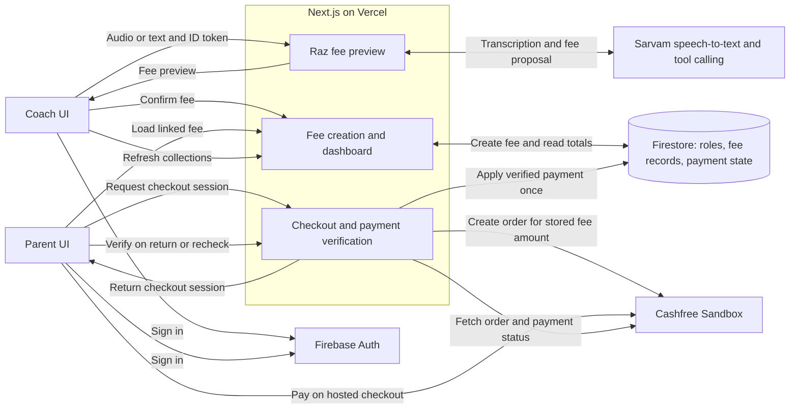
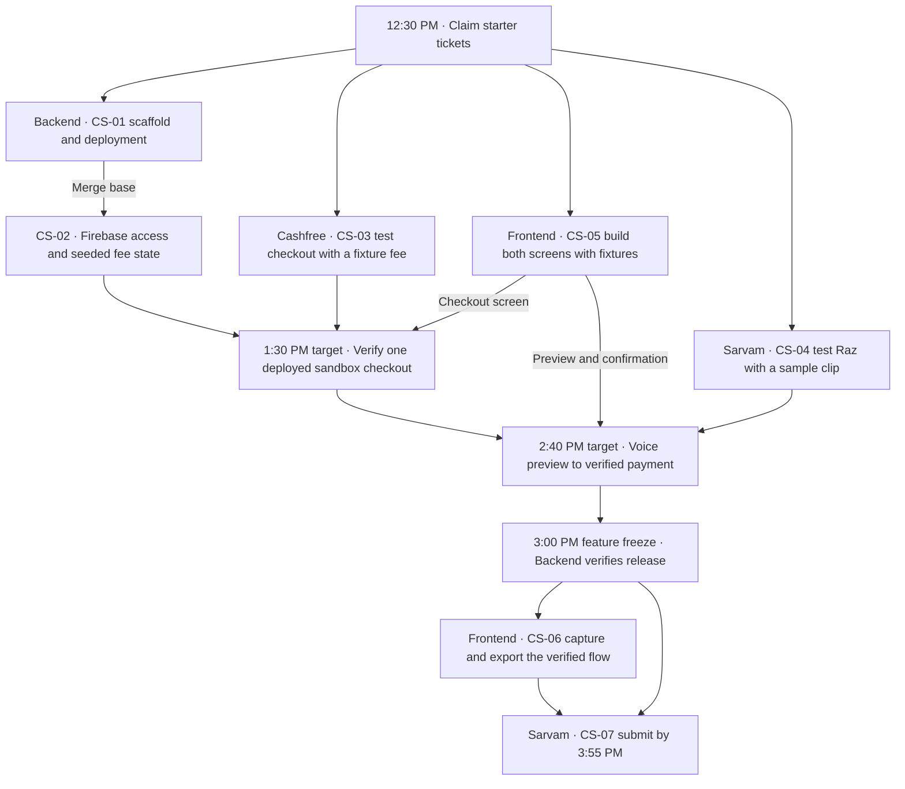

# Architecture and execution diagrams

See the [sprint spec](SPEC.md) for scope and timing and the [shared contract](CONTRACT.md) for interfaces.

## App architecture

## Ticket execution and handoffs

The arrows into a checkpoint show what must come together for live verification. Code can be developed using the written contract and fixtures before the merge base and neighboring routes are ready.

The [ticket board](../tickets/README.md) lists which owners can start immediately and the dependencies for live acceptance.
